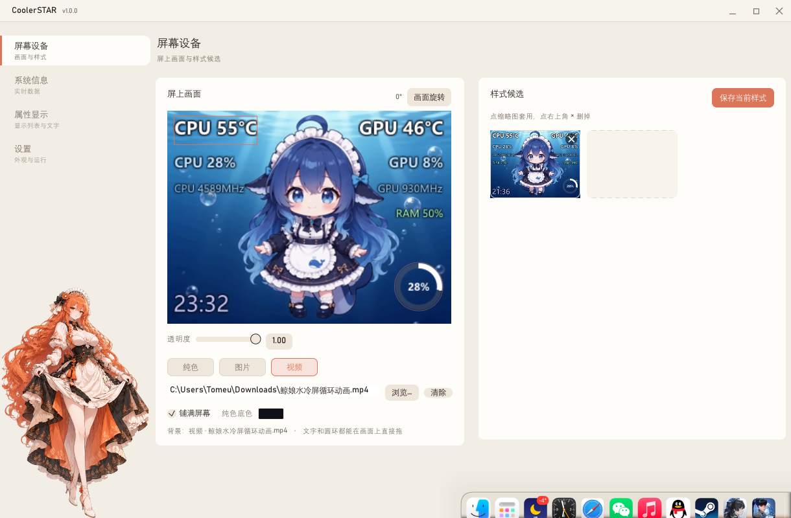

# CoolerSTAR

**影驰 Boomstar 星耀水冷控制台 · 第三方上位机**

[](https://www.rust-lang.org/)
[](https://www.microsoft.com/windows)
[](LICENSE)
[](https://github.com/KinkOwO/CoolerSTAR/releases)

驱动 320×240 水冷小屏（USBLCD 协议）的桌面程序。图片 / 视频背景 + 自定义文字叠加 + 系统传感器读数 + 可拖动的图形组件，用来替代厂商自带的 BOOMSTAR。

<p align="center">
  
</p>

---

## 特性

### 背景

- **纯色 / 图片 / 视频** 三种来源，支持铺满裁切或等比留边
- 视频整段解码进内存后循环播放，首尾交叉淡化
- 透明度滑杆对图片和视频同时生效

### 上屏内容

- **12 类数据字段**：CPU / GPU 温度、使用率、频率、功耗、风扇转速、内存、磁盘、时间
- 每项独立控制前缀文字、字号、字体、位置、颜色、底色块、加粗、单位、对齐、**描边**
- **环形进度表**组件：选数据源，调直径 / 环宽 / 字号 / 颜色
- 文字与圆环都能**在预览画面上直接拖动**

### 布局管理

- 「保存当前样式」把整套布局连同一张 4:3 缩略图存档（字段、圆环、背景、旋转角、主题）
- 缩略图网格 3 列 × 5 行，一页 15 格 = 14 个样式 + 1 个空框，满页自动翻页
- 点缩略图套用，点 `×` 二次确认后删除
- 画面旋转 0° / 90° / 180° / 270°，屏上与预览同步

### 外观

三套完整配色，各配一张角色立绘，切换时人物跟着换。

| 主题 | 底色 | 主色 | 立绘 |
|---|---|---|---|
| 明昼 | `#F1F2F2` | `#0070D5` | 白发精灵 |
| 黑夜 | `#0E1113` | `#4DA3FF` | 黑发 |
| 百日橘 | `#F2EEE5` | `#DB7658` | 橙发 |

无边框窗口 + 自绘标题条，四边四角可拖拽缩放，双击标题条最大化。

### 运行方式

- 目标帧率 1~30 fps（屏端是 ~31Hz 轮询，再高吃不下）
- 关窗 = **真·收进托盘**：窗口整块 `SW_HIDE`，不占任务栏、不进 Alt+Tab，后台继续出图
- 托盘左键叫回窗口，右键菜单（显示 / 开始停止出图 / 退出）
- 开机自启（写 `HKCU\Software\Microsoft\Windows\CurrentVersion\Run`）
- **不碰硬盘传感器**开关 —— 有些盘一查 SMART 就咔一下
- CPU 温度可手动指定读取哪一路传感器

---

## 快速开始

### 直接用

1. 下载 [Releases](https://github.com/KinkOwO/CoolerSTAR/releases) 里的压缩包
2. 解压，双击 `CoolerSTAR.exe`

不需要装 .NET 运行时。`bin\` 里自带三个依赖：

| 文件 | 作用 |
|---|---|
| `USBLCD.exe` | 屏幕服务，驱动水冷屏 |
| `HWINFO.exe` + `HWiNFO64.dll` | 传感器读数 |
| `ffmpeg.exe` | 视频背景解码 |

整个文件夹拷走就能在别的机器上跑。

### 从源码构建

需要 Rust stable 和 mingw-w64 工具链（`windres` 用于嵌入图标和版本信息）。

```bash
cd CoolerScreenRs
rustup target add x86_64-pc-windows-gnu
cargo +stable-x86_64-pc-windows-gnu build --release
```

产物在 `target/x86_64-pc-windows-gnu/release/CoolerSTAR.exe`。

> **没装 gcc 也能编。** mingw 精简安装里只有 `windres.exe` 没有 `gcc.exe` 时，
> `build.rs` 会把预处理器换成 `cmd /c type`，跳过预处理直接编译资源文件。

---

## 界面结构

左侧竖排四项导航。

| 页面 | 内容 |
|---|---|
| **屏幕设备** | 屏上画面实时预览（可拖文字/圆环）、透明度、背景来源、画面旋转、样式候选网格 |
| **系统信息** | CPU / GPU / 内存 / 存储四张实时卡片 + 上屏图形组件管理 |
| **属性显示** | 显示列表（字段增删与显隐）、文字属性编辑器、CPU 温度取哪一路 |
| **设置** | 主题外观、出图、屏幕服务、启动项、传感器、关于 |

---

## 技术细节

### 屏幕协议

水冷屏通过共享内存通信，名字 `shareMemory_Image`：

- 帧格式 `240 × 320 × 2` 字节（RGB565 小端），帧数据在 slot 1
- 写帧流程：slot 0 前 4 字节写 `[0x00, 0x00, 0x00, 0x1E]` → 拷帧 → 写 `[0x00, 0x01, 0x01, 0x1E]`
- 设计画布是 320×240，写屏前做 90° 旋转（`render.rs` 的 `to_screen_rot`）
- 共享内存段不存在时程序自己 `CreateFileMappingW` 建一个，所以能独立于 BOOMSTAR 运行

### 传感器

主源是 HWiNFO 的共享内存（`shareMemory_SysInfo`，2 MB），读不到时依次退回 LibreHardwareMonitor 和系统 API（`GlobalMemoryStatusEx` / `GetDiskFreeSpaceExW`）。

### 字体

数字用 Bahnschrift（DIN 系，仪表感），中文用等线（`Deng.ttf`），雅黑兜底。等线行高 1.05em、Bahnschrift 1.01em，比雅黑 1.33em 接近得多，混排时基线不会被压。

### 依赖

| crate | 用途 |
|---|---|
| `eframe` / `egui` 0.32 | 界面 |
| `image` 0.25 | 图片解码 |
| `ab_glyph` | 屏幕端文字光栅化 |
| `windows` 0.62 | Win32 / DWM / 托盘 / 共享内存 |
| `raw-window-handle` 0.6 | 从 eframe 拿 `HWND` |

---

## 项目结构

```
CoolerScreenRs/
├── build.rs            # 嵌入图标与版本信息（windres）
├── assets/             # 三张立绘 + 应用图标
└── src/
    ├── main.rs         # 界面与应用主体
    ├── render.rs       # 320×240 画布合成、文字/圆环绘制、屏幕旋转
    ├── screen.rs       # 共享内存写帧
    ├── sensors.rs      # 传感器采集（HWiNFO / LHM / 系统 API）
    ├── settings.rs     # 配置结构与读写
    ├── theme.rs        # 三套调色板
    ├── tray.rs         # 托盘图标与菜单
    ├── video.rs        # ffmpeg 解码
    └── autostart.rs    # 开机自启
```

配置存在 exe 同目录的 `settings.json`，纯文本，可直接编辑。

---

## 已知限制

- **CPU 温度**：部分主板（含开发用的这台）多路温度源都是固定死值，压测 100% 负载下读数不动。软件默认选 `SuperIO CPU`，但读数不随负载变化是硬件/驱动层面的问题，软件改不了。设置页可以手动换源试试。
- **帧率上限 31 fps**：USBLCD 是固定 ~31 Hz 轮询，目标帧率超过 30 没有意义。
- 仅支持 Windows。

---

## 许可

[MIT](LICENSE)

本程序为第三方工具，与影驰（GALAX）官方无关联。使用前请关闭 BOOMSTAR，避免两边同时抢屏。
